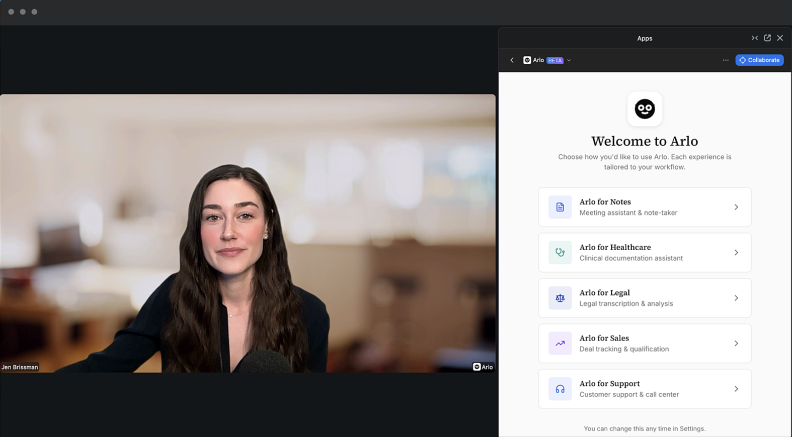
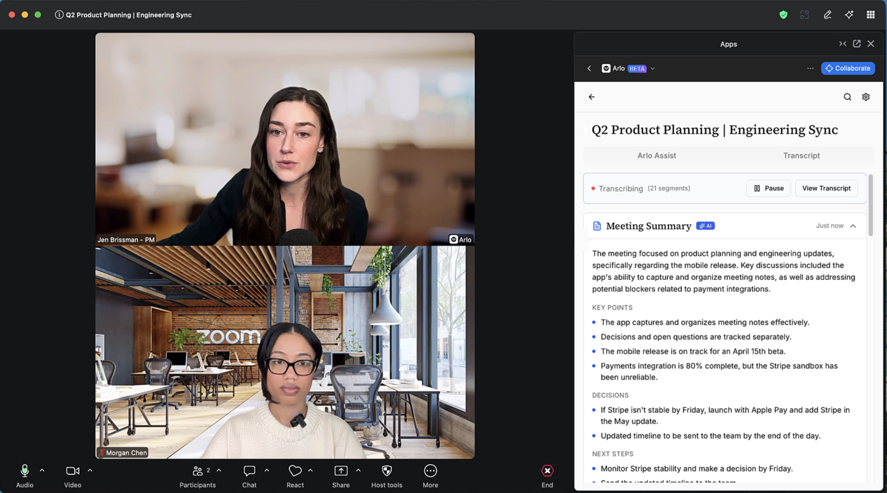
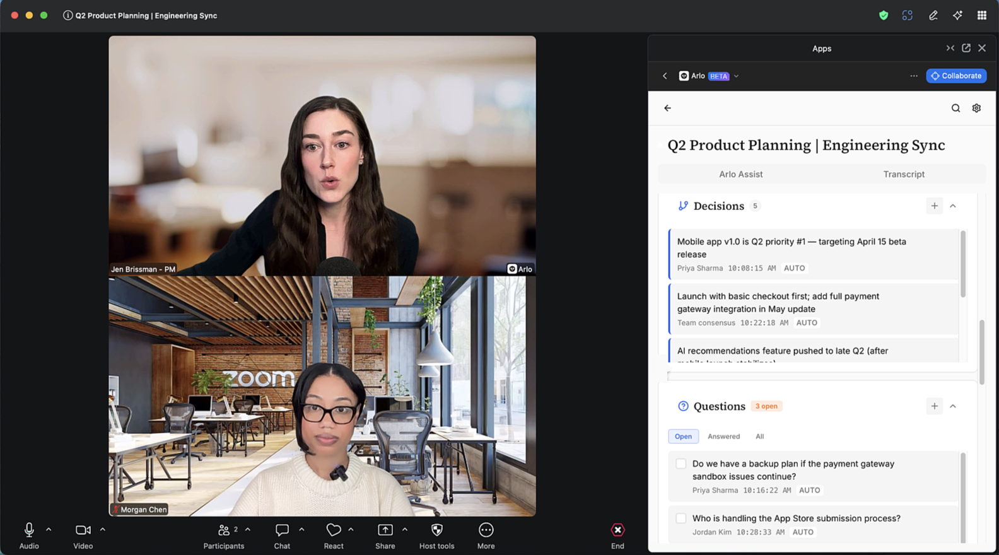
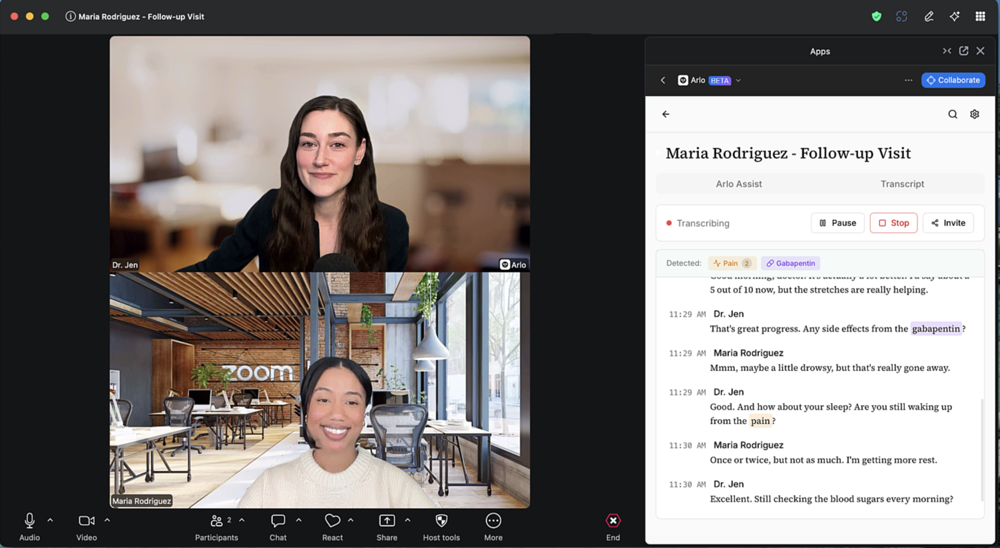
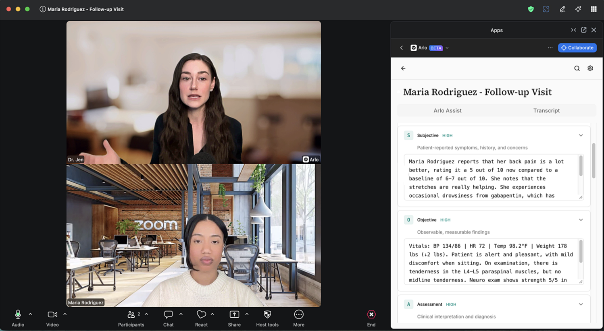
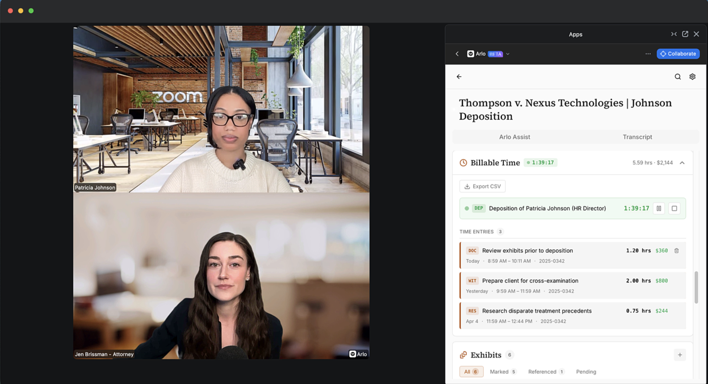
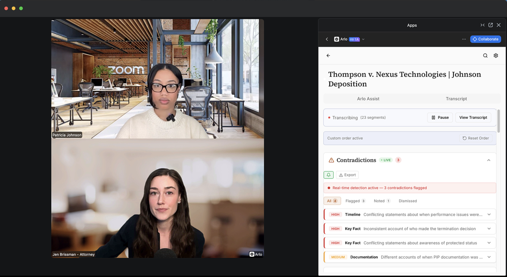
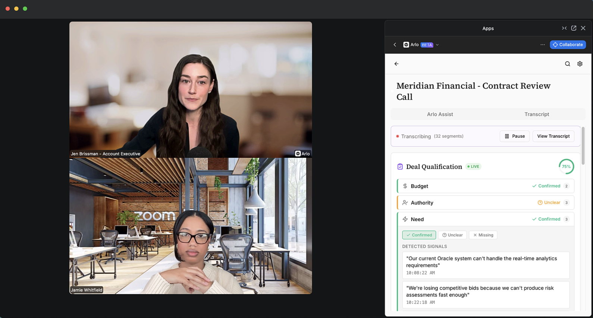
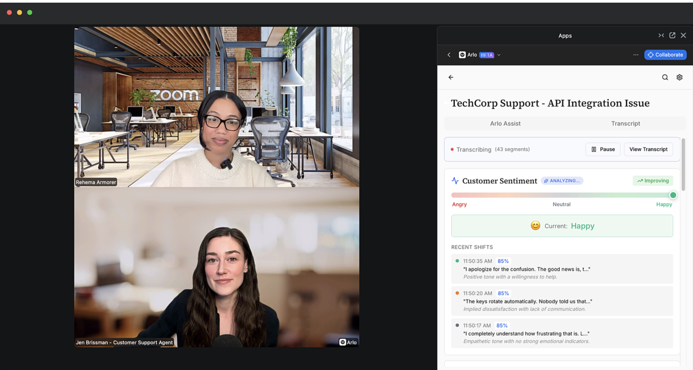

<div align="center">


# Arlo Meeting Assistant

**Build Real-Time Meeting Intelligence with Zoom RTMS**

[](./LICENSE)
[](https://nodejs.org/)
[](https://www.zoom.com/en/realtime-media-streams/)

[Get Started](#quick-start) · [See Demos](#see-it-in-action) · [Features](#features) · [Troubleshooting](#troubleshooting)

</div>

---

## What is Arlo?

Arlo is an **open-source reference implementation** that demonstrates the power of Zoom's RTMS (Real-Time Media Streams) APIs. It shows developers how to build meeting assistants that capture **live transcripts without requiring a bot in the meeting**.

<table>
<tr>
<td width="50%">

### Use This Project To

- **Learn** how RTMS webhooks, WebSockets, and transcript streaming work
- **Fork and customize** for your specific use case
- **Prototype** meeting intelligence applications
- **Understand** Zoom Apps authentication and best practices

</td>
<td width="50%">

### What You'll Build

- Live transcription with < 1 second latency
- AI-powered summaries and action items
- Full-text search across meetings
- Industry-specific modes (Healthcare, Legal, Sales)

</td>
</tr>
</table>

> **Note:** This is a starting point for developers. The industry verticals are illustrative examples showing what's possible with RTMS.

### Demo Mode (No Database)

This version of Arlo runs in **secure demo mode**, with no database. A meeting's transcript and notes are held **in memory only while that meeting runs** and are deleted when it ends:

- **Live transcription**, live notes and AI features work fully during active meetings
- **Catch-up for late joiners:** someone who opens Arlo mid-meeting, or reconnects, sees what was said so far
- **Nothing between meetings:** when a meeting ends its transcript and notes are deleted, so nothing from one meeting (or one customer demo) is available in the next
- **Nothing on disk:** no database and no files; a server restart also clears everything
- **No database setup:** configure Zoom credentials and go

**Want to add persistence?** If you're building a production app and need to store meeting history, search transcripts, or enable features like auto-open meetings, you'll want to add a database. We recommend:

1. **Choose a database** — MySQL, PostgreSQL, or your preferred data store
2. **Add an ORM** — Prisma works well with Node.js
3. **Store selectively** — Only persist what users consent to store

See the [Architecture docs](./docs/ARCHITECTURE.md) for database schema recommendations.

---

## See It In Action

<div align="center">



*Choose your workflow — each vertical is tailored to your industry*

### Video Demos

| Healthcare | Sales | Support |
|:----------:|:-----:|:-------:|
| [](https://youtu.be/F496oIqo6ls) | [](https://youtu.be/LKpZAe5_A8o) | [](https://youtu.be/1N6hs88nOhA) |
| [Watch Demo](https://youtu.be/F496oIqo6ls) | [Watch Demo](https://youtu.be/LKpZAe5_A8o) | [Watch Demo](https://youtu.be/1N6hs88nOhA) |

| Legal | Notes |
|:-----:|:-----:|
| [](https://youtu.be/WNM5YxRTrIU) | [](https://youtu.be/4N-g5TgGRz0) |
| [Watch Demo](https://youtu.be/WNM5YxRTrIU) | [Watch Demo](https://youtu.be/4N-g5TgGRz0) |

</div>

---

## What You See in a Meeting

Arlo shows one screen at a time. Which one depends on whether Arlo is in the meeting and on who you are.

| Screen | Who sees it | What it does |
|--------|-------------|--------------|
| **Bring Arlo into this meeting** | The host or a co-host, signed in to Arlo | Choose who can ask Arlo ("Only I can ask" or "Anyone can ask"), then one button. Nothing is requested from Zoom before the click. |
| **Ask the host to bring Arlo in** | Other signed-in users | One button. Zoom asks the host; the screen waits for the answer. |
| **Live notes** | Each person using Arlo (they started it for themselves) | A summary, decisions and action items, rewritten about every 45 seconds while people talk. A status line with Pause, Resume and Remove Arlo while your own Arlo runs; if yours has stopped and someone else's still runs, the notes continue and the line offers "Bring Arlo back". An "Ask Arlo" input; the answer comes from the transcript and only you see it. **Share notes with everyone** makes the notes live in the Arlo panel of everyone in the meeting, until you click **Stop sharing**. **Post notes to chat** is a one-time copy: it puts the current notes into the Zoom meeting chat for everyone, after you confirm. When a participant asks for the notes, a sheet over the notes asks "Share the notes with everyone in the meeting?": **Share notes** turns sharing on, **Not now** declines, and it goes away by itself after a minute. |
| **Participant view** | Everyone else, including people not signed in | Who brought Arlo in and what Arlo does. The notes only while the person who brought Arlo in shares them: then they are live in this panel too, read-only, under "… is sharing Arlo's notes", and they disappear when sharing stops. "Ask Arlo" appears when the owner chose "Anyone can ask" and you are signed in; otherwise it says "Only people using Arlo can ask in this meeting." Signed-in people have two choices: **Ask … to share notes with everyone** (the person who brought Arlo in is asked, and if they agree the notes appear in everyone's panel), and **Take notes yourself** (unless the deployment sets `ALLOW_OWN_ARLO_STREAM=false`): it starts Arlo for you too, under your own permission (the host may have to allow it), and you then get the notes screen and can ask. |
| **Meeting record** | Everyone in the meeting | What was said and what happened since Arlo joined, in time order. A toggle shows only Arlo's own actions. |
| **After the meeting** | Each person who used Arlo, and anyone who was reading shared notes | The notes stay on screen with a "Copy notes" button. In demo mode they are not stored anywhere else. |

How it works:

- **Who gets the notes.** Each Arlo user who runs a transcript stream of their own in the meeting gets the notes. Everyone else gets the participant view, without the notes unless one of those users shares them: sharing shows the notes live to everyone in the meeting who has Arlo open, signed in or not, until it is stopped. Pause, Resume and Remove Arlo are shown only to those users, because they act on the user's own stream. A host stops someone else's stream with Zoom's own controls.
- **Several streams, one transcript.** Several users can each run a stream in the same meeting. The server stores one transcript: a line from any of the streams is stored, unless the same line (same speaker, same words, close in time) was just stored from another stream. No stream is preferred, so a stream that stops, falls behind or goes silent loses nothing. Pause is per stream: the meeting shows as paused only when every running stream is paused.
- **Known gap: several people using Arlo at once.** Arlo learns of a stream, and of whose it is, from Zoom's `meeting.rtms_started` webhook. In a test with two users of the app in one meeting (2026-11-23), the second person's start produced no second webhook, only a session-added event on the first person's RTMS connection, which does not say whose session it is. Without that webhook Arlo cannot tell whose stream it is, so the second person does not get the notes. "Take notes yourself" is offered by default all the same: when no webhook arrives, the second person sees a message that Arlo has not joined, ending in "Try again", and stays on the participant view; the first person's Arlo is not affected. Set `ALLOW_OWN_ARLO_STREAM=false` to hide the action.
- **When the meeting ends.** The server deletes the transcript, the notes and the record of who brought Arlo in. A panel that is still open keeps showing the notes it already has.
- **Later: shared notes outside the meeting.** Opening shared notes from a link outside the meeting is not built. Shared notes are seen in the Arlo panel, inside the meeting.
- **The earlier dashboard** (tabs, vertical cards, suggestions) is still in the app. While in a meeting, open Settings and choose **Classic dashboard**.

---

## Features

> The table lists everything in the code base. The in-meeting panels it mentions (voice command responses, vertical cards, suggestions, drag-and-drop layout) are on the classic dashboard. Search, history, highlights and export need a database and are off in demo mode.

| Feature | Description |
|---------|-------------|
| **Live Transcription** | Real-time captions via RTMS (< 1 second latency) |
| **Voice Commands** | Say "Arlo, summarize" or "Arlo, action items" during meetings |
| **AI Insights** | Summaries, action items, and next steps powered by OpenRouter |
| **Full-Text Search** | Search across all your meeting transcripts instantly |
| **Chat with Transcripts** | Ask questions about your meetings using AI |
| **Meeting Highlights** | Create bookmarks with timestamps for key moments |
| **Export Options** | Download WebVTT files or Markdown summaries |
| **Dark Mode** | Automatic OS detection with manual toggle |
| **Filler Word Coach** | Real-time detection of filler words with audio alerts (Sales vertical) |
| **AI Sentiment Analysis** | Real-time customer sentiment tracking with trend visualization (Support vertical) |
| **Compliance Advisor** | Real-time compliance monitoring for regulated industries |
| **Guest Access** | Non-authenticated users can view transcripts via meeting links |
| **Collapsible UI Cards** | Expandable/collapsible cards for cleaner interface management |
| **Drag-and-Drop Layout** | Reorder and customize card positions in the meeting view |
| **Show AI Prompts** | Developer tool to inspect the AI prompts powering each feature |
| **Industry Verticals** | Specialized modes: Arlo for Notes, Healthcare, Legal, Sales, and Support |

> **AI features work out of the box** — no API key required! Arlo uses [OpenRouter](https://openrouter.ai/) with free models (Gemini, Llama). Optional: add your own `OPENROUTER_API_KEY` for higher rate limits.

---

## Voice Commands

Control Arlo hands-free during meetings. Just say the wake word followed by a command:

| Command | What It Does |
|---------|--------------|
| "Arlo, summarize" | Generate a meeting summary |
| "Arlo, action items" | Extract action items and to-dos |
| "Arlo, highlight this" | Create a bookmark at the current moment |
| "Arlo, decisions" | Show key decisions made |
| "Arlo, questions" | Show open/unanswered questions |
| "Arlo, send to chat" | Send summary to meeting chat |
| "Arlo, help" | Show available commands |

**Alternate wake words:** "Hey Arlo", "Hi Arlo"

Responses appear inline in the meeting view. You can toggle response visibility in Settings.

---

## Settings

Access settings via the gear icon in the app. Available options:

### Transcription

| Setting | Description |
|---------|-------------|
| **Auto-open in meetings** | Automatically open Arlo when you join scheduled meetings |
| **Auto-start transcription** | Begin transcription immediately when the app opens |

### Demo Mode

| Setting | Description |
|---------|-------------|
| **Show sample data** | Display example data to demonstrate features. Turn off to only see real meeting data. |

### Classic dashboard

| Setting | Description |
|---------|-------------|
| **Classic dashboard** | Shown only while in a meeting. Opens the earlier dashboard, kept while the new screens are tried. |

### Chat Notifications

| Setting | Description |
|---------|-------------|
| **Enable Chat Notifications** | Send automatic messages to Zoom chat when transcription events occur |
| **Event toggles** | Choose which events trigger notifications (start, pause, resume, stop, restart) |
| **Message templates** | Customize the message text for each event. Use `[meeting-id]` as a placeholder. |

### Voice Commands

| Setting | Description |
|---------|-------------|
| **Show Arlo Responses** | Display voice command responses in the meeting view. Turn off for cleaner demos. |

### Developer Tools

| Setting | Description |
|---------|-------------|
| **Start/Stop via REST API** | Test RTMS control using Zoom's participant REST API instead of the client SDK. Useful for automation and testing. |

### AI Configuration

| Setting | Description |
|---------|-------------|
| **AI Provider** | Choose between OpenRouter (default, free), Anthropic, OpenAI, or Custom |
| **API Key** | Your API key (stored locally, never sent to Arlo's servers) |
| **Model** | Select which AI model to use for summaries and insights |

---

## Prerequisites

Before you begin, ensure you have:

| Requirement | Why You Need It |
|-------------|-----------------|
| **[Node.js 20+](https://nodejs.org/)** | Runtime for backend services |
| **[Docker Desktop](https://www.docker.com/products/docker-desktop/)** | Runs all services in containers |
| **[ngrok](https://ngrok.com/)** | Creates secure tunnels for Zoom webhooks |
| **[Zoom Account](https://marketplace.zoom.us/)** | To create and configure your Zoom App |

### RTMS Access Required

> **This app requires RTMS access from Zoom.** RTMS (Real-Time Media Streams) enables live transcript streaming.
>
> **[Request RTMS Access](https://www.zoom.com/en/realtime-media-streams/#form)** — Apply early, approval may take a few days.

---

## Quick Start

### 1. Clone & Set Up ngrok

```bash
# Clone the repository
git clone https://github.com/zoom/arlo.git
cd arlo
```

Start ngrok to create a public URL for Zoom webhooks:

```bash
# Option A: Static domain (recommended - free, doesn't change)
ngrok http 3000 --domain=your-name.ngrok-free.app

# Option B: Random domain (changes each restart)
ngrok http 3000
```

> **Tip:** Get a free static domain at [ngrok dashboard → Domains](https://dashboard.ngrok.com/domains) to avoid reconfiguring Zoom settings.

**Keep this terminal running** and note your URL (e.g., `https://your-name.ngrok-free.app`).

---

### 2. Create Your Zoom App

1. Go to **[Zoom Marketplace](https://marketplace.zoom.us/)** → Develop → Build App
2. Select **General App** → name it (e.g., "Arlo Meeting Assistant")
3. Copy your **Client ID** and **Client Secret**
4. *(Optional)* Set the app icon: click the icon next to the app name and upload the 160×160 PNGs in [`docs/assets/marketplace/`](./docs/assets/marketplace/). Use `arlo-icon-160.png` for light mode and `arlo-icon-160-dark.png` for dark mode. You have to upload the icon yourself because the manifest has no icon field.

#### Optional: configure the app from the manifest

[`zoom-app-manifest.json`](./zoom-app-manifest.json) contains every setting from [Step 4](#4-configure-zoom-app-settings): scopes, Zoom Apps SDK APIs, OAuth, domain allow list, and event subscriptions. If your account can upload app manifests (a Marketplace beta), you can upload it instead of configuring each setting by hand.

> **Before uploading, replace the ngrok URL everywhere it appears in the manifest.** The placeholder `your-ngrok-url.ngrok-free.app` appears 8 times: OAuth redirect URIs, OAuth allow list, home URLs, domain allow list, and webhook URLs. If you miss one, OAuth, the app panel, or RTMS webhooks will fail. Replace only the hostname; the manifest already includes `https://` and the paths.
>
> ```bash
> # Writes a filled-in copy and leaves the template unchanged. Use your full ngrok hostname (it may end in .ngrok-free.dev).
> sed 's/your-ngrok-url\.ngrok-free\.app/YOUR-NAME.ngrok-free.app/g' zoom-app-manifest.json > my-zoom-app-manifest.json
> grep -c 'your-ngrok-url' my-zoom-app-manifest.json   # should print 0
> ```
>
> Upload the filled-in copy, not the template, and don't commit it. If your ngrok URL changes later, update the same 8 fields in the Marketplace.

---

### 3. Configure Environment

```bash
cp .env.example .env
```

Edit `.env` with your values:

```bash
# From Zoom Marketplace (Step 2)
ZOOM_CLIENT_ID=your_client_id
ZOOM_CLIENT_SECRET=your_client_secret
ZOOM_WEBHOOK_TOKEN=your_secret_token   # Features → Access → Secret Token (required for RTMS webhooks)

# Your ngrok URL (Step 1)
PUBLIC_URL=https://your-name.ngrok-free.app

# Generate secrets (run these commands, paste the output)
SESSION_SECRET=            # node -e "console.log(require('crypto').randomBytes(32).toString('hex'))"
TOKEN_ENCRYPTION_KEY=      # node -e "console.log(require('crypto').randomBytes(32).toString('hex'))"

# Optional: live notes
NOTES_MODEL=               # Model that writes the notes; one of OPENROUTER_MODELS, otherwise DEFAULT_MODEL
NOTES_INTERVAL_MS=45000    # How often the notes are rewritten while people talk (15000 to 600000)
```

---

### 4. Configure Zoom App Settings

In [Zoom Marketplace](https://marketplace.zoom.us/) → Your App:

<details>
<summary><strong>Basic Information</strong></summary>

| Setting | Value |
|---------|-------|
| OAuth Redirect URL | `https://YOUR-NGROK-URL/api/auth/callback` |
| OAuth Allow List | `https://YOUR-NGROK-URL` |

</details>

<details>
<summary><strong>Scopes</strong></summary>

Add these OAuth scopes (granular):
- `zoomapp:inmeeting` — Run the app inside meetings
- `meeting:read:meeting` — Read meeting details
- `meeting:read:meeting_transcript` — Receive live transcripts via RTMS (search "RTMS"; requires RTMS access)
- `meeting:read:list_meetings` — List upcoming meetings
- `meeting:write:open_app` / `meeting:delete:open_app` — Register/unregister auto-open in a meeting (optional)
- `user:read:user` — Read user profile (optional)
</details>

<details>
<summary><strong>Features → Zoom App SDK</strong></summary>

- Click **Add APIs** and enable required capabilities, including `startRTMS`, `stopRTMS`, `pauseRTMS`, `resumeRTMS`, and `getAppContext`
- Optional: `setDynamicIndicator` and `removeDynamicIndicator`, to show Arlo's status ("Arlo is transcribing") in Zoom's meeting window for everyone in the meeting
- Enable **In-client OAuth** and **Guest mode**

</details>

<details>
<summary><strong>Features → Surface</strong></summary>

| Setting | Value |
|---------|-------|
| Home URL | `https://YOUR-NGROK-URL` |
| Domain Allow List | `https://YOUR-NGROK-URL` |

</details>

<details>
<summary><strong>Features → Event Subscriptions</strong></summary>

| Setting | Value |
|---------|-------|
| Event notification endpoint | `https://YOUR-NGROK-URL/api/rtms/webhook` |
| Events to subscribe | `meeting.rtms_started`, `meeting.rtms_stopped`, `meeting.rtms_interrupted` |

</details>

> Replace `YOUR-NGROK-URL` with your actual ngrok URL (e.g., `your-name.ngrok-free.app`)

---

### 5. Start the Application

```bash
docker-compose up --build
```

Wait for all services to start:
- Backend API (port 3000)
- Frontend (port 3001)
- RTMS service (port 3002)

---

### 6. Test in Zoom

1. Start or join a Zoom meeting
2. Click **Apps** in the toolbar
3. Find and open your app
4. As the host, click **"Bring Arlo into this meeting"**
5. Talk for a minute: the notes appear (Summary, Decisions, Action items)
6. Type a question into **Ask Arlo**
7. Open **Meeting record** to see the transcript and what Arlo did
8. Open Arlo from a second account in the same meeting to see the participant view
9. From that second account, click **"Ask … to share notes with everyone"**: the first account gets a sheet, and **Share notes** makes the notes appear in the second account's panel (and in everyone else's)
10. From that second account, click **"Take notes yourself"**: Arlo starts for that person too and they get the notes (see the known gap above: this can end on "Try again")
11. On the first account, click **Stop sharing** under the notes: they disappear from the second account's panel. **Share notes with everyone** brings them back

---

## Industry Verticals

Arlo includes specialized modes demonstrating RTMS capabilities for different industries. Each vertical shows how real-time transcription can power domain-specific features.

### Arlo for Notes
**Full-Featured Note-Taking** — Meeting summaries, key decisions, action items, and open questions tracked automatically.

[](https://youtu.be/4N-g5TgGRz0)

<p align="center">


</p>

---

### Arlo for Healthcare
**Clinical Documentation** — SOAP notes auto-generation, medication and symptom detection, clinical terminology highlighting.

[](https://youtu.be/F496oIqo6ls)

<p align="center">


</p>

---

### Arlo for Legal
**Deposition Assistance** — Real-time contradiction detection, billable time tracking with export, and exhibit management.

[](https://youtu.be/WNM5YxRTrIU)

<p align="center">


</p>

---

### Arlo for Sales
**Deal Intelligence** — BANT qualification tracking (Budget, Authority, Need, Timeline), competitor mentions, and commitment detection.

[](https://youtu.be/LKpZAe5_A8o)

<p align="center">

</p>

#### Filler Word Coach

Real-time filler word detection with audio alerts to help improve speaking cadence during sales calls and pitches.

| Feature | Description |
|---------|-------------|
| **Live Detection** | Detects filler words ("um", "like", "you know", "basically", etc.) in real-time |
| **Audio Alerts** | Plays a subtle beep when filler words are detected (can be muted) |
| **Statistics** | Tracks frequency of each filler word with visual breakdown |
| **Customizable** | Add or remove words from the detection list |
| **Recent History** | Shows your last 5 detections with timestamps |

**Default tracked words:** "so", "like", "you know", "basically", "actually", "literally", "um", "uh", "er", "ah", "right", "okay so", "i mean", "kind of", "sort of"

---

### Arlo for Support
**Agent Assistance** — Live customer sentiment meter with trend analysis and emotional shift tracking.

[](https://youtu.be/1N6hs88nOhA)

<p align="center">

</p>

> **Building your own vertical?** Fork this repo and customize the frontend components in `frontend/src/features/` for your specific use case.

---

## Developer Tools

Arlo includes built-in tools to help developers understand how the AI features work.

### Show AI Prompts

Enable this setting to reveal the exact prompts powering each AI feature. When enabled, small info icons appear next to AI-powered components (Meeting Summary, SOAP Notes, Sentiment Meter, etc.). Click the icon to see:

- **System Prompt** — The instructions given to the AI
- **User Prompt Template** — How user input is formatted
- **Output Format** — Expected response structure
- **Copy to Clipboard** — Easily copy prompts for your own experiments

**To enable:**
1. Go to **Settings** (gear icon)
2. Scroll to **Developer Tools** section
3. Toggle **"Show AI Prompts"** on

This is useful for:
- Understanding how Arlo's AI features work under the hood
- Learning prompt engineering techniques
- Customizing prompts for your own fork

### API Endpoints for Prompts

```
GET /api/ai/prompts          # List all available prompts
GET /api/ai/prompts/:id      # Get specific prompt (summary, sentiment, soapNotes, etc.)
```

---

## Troubleshooting

<details>
<summary><strong>Clean Restart</strong></summary>

If you're having persistent issues:

```bash
# Stop everything and remove volumes
docker-compose down -v

# Rebuild with fresh node_modules
docker-compose up --build -V
```

</details>

<details>
<summary><strong>ngrok Issues</strong></summary>

**App stops working after restarting ngrok?**

If using a random domain:
1. Copy the new ngrok URL
2. Update `PUBLIC_URL` in `.env`
3. Update all URLs in Zoom Marketplace settings
4. Restart: `docker-compose restart backend`

> **Pro tip:** Use a [static ngrok domain](https://dashboard.ngrok.com/domains) (free) to avoid this!

</details>

<details>
<summary><strong>More Help</strong></summary>

See the full [Troubleshooting Guide](./docs/TROUBLESHOOTING.md) for additional issues.

</details>

---

## Documentation

| Document | Description |
|----------|-------------|
| [Architecture](./docs/ARCHITECTURE.md) | System design and data flow |
| [Project Status](./docs/PROJECT_STATUS.md) | Roadmap and current progress |
| [Specification](./SPEC.md) | Feature spec and milestones |
| [Troubleshooting](./docs/TROUBLESHOOTING.md) | Common issues and fixes |
| [CLAUDE.md](./CLAUDE.md) | Quick reference for AI assistants |

---

## Development

### Project Structure

```
arlo/
├── backend/           # Express API server
├── frontend/          # React Zoom App (Vite)
├── rtms/              # RTMS transcript ingestion service
├── terraform/         # AWS deployment configuration
├── docs/              # Documentation
└── docker-compose.yml # Development environment
```

### Common Commands

```bash
docker-compose up                    # Start all services
docker-compose logs -f backend       # View backend logs
docker-compose restart backend       # Restart a service
docker-compose down -v               # Stop and remove volumes
```

### Tech Stack

| Layer | Technology |
|-------|------------|
| Frontend | React 18, Zoom Apps SDK, Base UI |
| Backend | Node.js 20, Express |
| Storage | In-memory (demo mode) |
| AI | OpenRouter (free models available) |
| Real-time | WebSocket + RTMS SDK |

---

## Contributing

This is an open-source starter kit designed to be forked and customized!

1. **Fork** this repository
2. **Customize** for your use case
3. **Share** improvements via pull request

### Ideas for Extension

- Multi-language transcription support
- Custom AI models (local LLMs)
- Team workspaces and sharing
- Calendar integration
- Video replay with transcript sync

---

## Zoom for Government

This application supports Zoom for Government (ZfG) deployments:

```bash
# In your .env file
ZOOM_HOST=zoomgov.com
```

1. Create your app in the [Zoom for Government Marketplace](https://marketplace.zoomgov.com/)
2. Use ZfG-specific URLs in your configuration

> **Note:** RTMS availability on ZfG may differ. Contact your Zoom representative for ZfG-specific access.

---

## Production Deployment

### Deploy to Render (One-Click)

The easiest way to deploy Arlo to production is with [Render](https://render.com/):

[](https://render.com/deploy?repo=https://github.com/zoom/arlo)

This deploys all services (backend, frontend, RTMS) with automatic secret generation. After deployment:

1. Add your Zoom credentials in the Render dashboard:
   - `ZOOM_CLIENT_ID`
   - `ZOOM_CLIENT_SECRET`
   - `ZOOM_WEBHOOK_TOKEN`
2. Update your Zoom App settings with the Render URLs
3. That's it — you're live!

See [`render.yaml`](./render.yaml) for the full infrastructure configuration.

---

### Deploy to AWS (Terraform)

For AWS deployment, use the Terraform configuration in the `terraform/` directory:

```bash
cd terraform
terraform init
terraform plan
terraform apply
```

This provisions:
- EC2 instances for backend and RTMS services
- Application Load Balancer with TLS
- Auto-generated secrets via AWS Secrets Manager

See the [terraform/README.md](./terraform/README.md) for detailed AWS setup instructions.

---

### Production Considerations

This reference implementation is designed for **learning and prototyping**. Before production deployment:

| Area | Development | Production Recommendation |
|------|-------------|---------------------------|
| **Credentials** | `.env` file | Secrets manager (AWS, Vault, Azure) |
| **Tokens** | In-memory + AES | Database with encryption at rest |
| **Sessions** | In-memory | Redis or database-backed |
| **HTTPS** | ngrok tunnel | Load balancer with TLS |
| **WebSockets** | Single instance | Redis pub/sub for scaling |
| **Data Storage** | None (demo mode) | Add database for persistence |

See [Known Limitations](#known-limitations) for additional considerations.

---

## Known Limitations

This is a reference implementation with intentional simplifications:

| Pattern | Current | Production Recommendation |
|---------|---------|---------------------------|
| PKCE Storage | In-memory Map | Redis with TTL |
| WebSocket Scaling | Single-instance | Redis pub/sub adapter |
| Retry Logic | Basic 401 retry | Exponential backoff |
| Webhook Processing | Synchronous | Queue-based async |
| Input Validation | Basic checks | Schema validation (Zod) |

---

## Resources

- [Zoom Apps Documentation](https://developers.zoom.us/docs/zoom-apps/)
- [RTMS Documentation](https://developers.zoom.us/docs/rtms/)
- [Zoom Apps SDK Reference](https://appssdk.zoom.us/classes/ZoomSdk.ZoomSdk.html)
- [OpenRouter API](https://openrouter.ai/docs)

---

## Support

- **Issues:** [GitHub Issues](https://github.com/zoom/arlo/issues)
- **Discussions:** [GitHub Discussions](https://github.com/zoom/arlo/discussions)
- **RTMS Access:** [Request Form](https://www.zoom.com/en/realtime-media-streams/#form)
- **Zoom Developer Forum:** [devforum.zoom.us](https://devforum.zoom.us/)

---

## License

MIT License — See [LICENSE](./LICENSE) for details.

---

<div align="center">

**Ready to build your own meeting assistant?**

[Get Started](#-quick-start) · [Star this repo](https://github.com/zoom/arlo)

</div>
